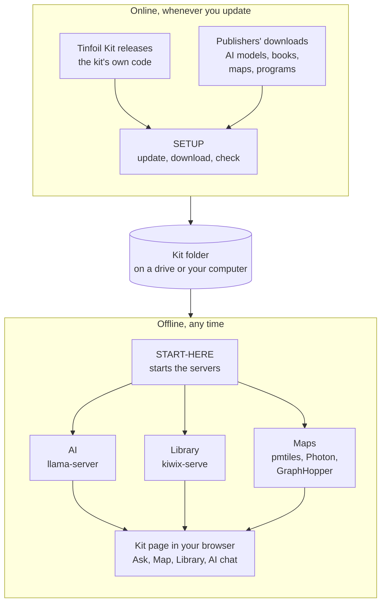

# Tinfoil Kit

An offline kit for when the internet goes down. One folder, on your computer or an external SSD, holds:

- **Local AI** (llama.cpp) that answers from the library and cites its sources.
- **An offline library** (Kiwix): Wikipedia, medical references, repair guides, preparedness manuals.
- **Offline maps** with address search, driving and walking directions, and "nearest hospital".

Open the kit folder (or plug in the drive it's on), double-click `START-HERE.command` (`START-HERE-Windows.bat` on Windows), and a browser page opens with Ask, AI chat, Library and Map tabs. No internet, account or install needed.


## How it works

The whole kit is one folder. Put it on an external drive to grab and go, or on your computer's own disk. While you're online, `SETUP.command` fills it. When the internet is down, `START-HERE.command` starts a few servers from it on your computer, and your browser talks to them. Nothing goes over the internet.



### Setting up (online)

The first time, `SETUP.command` asks where the kit goes: an external drive (`<drive>/TinfoilKit`) or this computer (`~/TinfoilKit`, where it leaves 50 GB free and stays out of Time Machine). `./kit drives` lists the drives with their format and free space, and `./kit place` moves the kit there. Then, that time and every time after, it runs three `./kit` commands (`tools/kit.py`: standard-library Python plus curl):

1. **Update** (`./kit update`): installs the kit's own code from the newest Tinfoil Kit release on GitHub, keeping your changes to `kit.json`. It installs only a release signed with the maintainer's key, and shows what's new and asks first.
2. **Download** (`./kit sync`): asks each publisher for the newest version of everything listed in [kit.json](kit.json) and downloads only what changed. A big book can wait for its next edition: Wikipedia (115 GB) keeps the one it has until it's a year old (`refresh_days` in kit.json). Downloads resume after a break, every file with a published checksum is checked against it, and an old version is deleted only after the new one checks out.
3. **Check** (`./kit test`): starts every server offline and checks that each one answers.

### Using it (offline)

`START-HERE.command` (`tools/launch.sh`; `START-HERE-Windows.bat` on Windows) starts these servers on your computer and opens the kit page at http://127.0.0.1:8888. It picks an AI model that fits the computer's memory. `bash START-HERE.command --share` lets phones on the same Wi-Fi use it too.

| Part | Program | Port | What it does |
| --- | --- | --- | --- |
| AI | `llama-server` (llama.cpp) | 8080 | Runs the AI model (Inkling 2 Mini by default). AI chat is its built-in chat page |
| Library | `kiwix-serve` (Kiwix) | 8888 | Serves the books (`.zim` files: Wikipedia, medical, repair, preparedness) with full-text search, and the kit page |
| Map | `pmtiles` | 8090 | Serves the map: street detail for your region (the US Northeast by default) and a low-detail world |
| Addresses | Photon | 2322 | Finds addresses, places and the nearest hospital or pharmacy (the whole US by default) |
| Directions | GraphHopper | 8989 | Plans driving and walking routes in your region |

Photon and GraphHopper run on a Java that's in the kit. On Windows and Linux, only the AI and the library start for now.

The kit page (`tools/portal.html`) is one HTML file with no build step. Each sync builds a copy with the map's code, fonts and icons inside, so the page needs nothing from the internet.

- **Ask:** the AI turns your question into short searches, `kiwix-serve` searches every book, and the AI answers from the top articles with numbered sources. With the AI off, Ask shows the best passages instead. Map questions ("nearest pharmacy", "directions to the hospital") skip the library: the AI gets three map tools (search places, find nearby, get directions), and the answer shows on the Map tab.
- **Map:** MapLibre draws the map from `pmtiles`. Its search, directions and "nearest" buttons ask Photon and GraphHopper.

### What's in the folder

```text
TinfoilKit/
├── SETUP.command           set up, or update whenever you like (online)
├── UNINSTALL.command       remove the kit and everything it downloaded
├── START-HERE.command      start the kit offline (Mac, Linux)
├── START-HERE-Windows.bat  start the kit offline (Windows)
├── GUIDE.md                the printable guide
├── INVENTORY.md            what's installed, with versions and sizes
├── kit, kit.json, tools/   the kit's code and its list of downloads
├── bin/                    programs: llama.cpp, Kiwix, Java, the map servers
├── models/                 AI models
├── library/                books (.zim files)
├── maps/                   map tiles, address database, road network
├── installers/             the Kiwix app, a backup way to read the books
├── logs/                   what each sync and launch did
└── .kit/                   download progress, caches, the built kit page
```

The repo is the kit, so `site/` (the website), `tests/` and `docs/` come along, but the kit doesn't use them.

## Requirements

- A modern laptop or desktop: a Mac with Apple Silicon, or a Windows or Linux PC. Built around 32 GB of memory; the small model runs on 8-16 GB.
- Room for the kit: the first sync downloads about 300 GB. On the computer's own disk it leaves 50 GB free. An external SSD lets you grab it and go.

For now, setup and the map need a Mac. On Windows and Linux the kit runs the library and the AI. A nightly test sets the kit up on a Mac and starts it on all three.

## Set up

Download the kit (**Code > Download ZIP** on GitHub), unzip it, and double-click `SETUP.command` in the unzipped folder. macOS asks once before it opens a script from the internet: open **System Settings > Privacy & Security** and click **Open Anyway**. SETUP asks whether the kit goes on an external drive or on this Mac, moves it there, downloads everything and tests it. Or from Terminal:

```sh
git clone https://github.com/tudor-city-ventures/tinfoilkit ~/TinfoilKit    # or /Volumes/<drive>/TinfoilKit
cd ~/TinfoilKit
./kit plan    # preview what will download
./kit sync    # download everything (a few hours)
./kit test    # start every server offline and check it answers
```

Then turn Wi-Fi off and double-click `START-HERE.command`. [GUIDE.md](GUIDE.md) is the printable guide that lives in the kit folder.

## Update

Double-click `SETUP.command` again whenever you want the newest models, books and maps, or run `./kit update`, `./kit sync` and then `./kit test`. There's no schedule. It installs the kit's newest version first, so models and sources added to the kit since then arrive too, and then downloads only what changed (see [How it works](#how-it-works)). If an update is cut off, the kit keeps working with what it has.

## Remove

Double-click `UNINSTALL.command` in the kit folder. It says what it will delete and how much space that frees, and deletes the kit and everything it downloaded only after you type `delete`. On a drive, nothing else is touched. `bash UNINSTALL.command --yes` skips the question.

## Customize

Everything the kit keeps is listed in [kit.json](kit.json). Set `"enabled": false` to skip an item, or find more books with `./kit search WORDS`.

## Contributing

Bug reports and ideas are welcome as issues. A pull request needs an issue the maintainer has labeled `accepted` first: see [CONTRIBUTING](.github/CONTRIBUTING.md). Code rules, for people and their AI agents, are in [AGENTS.md](AGENTS.md). Design history is in [docs/HANDOFF.md](docs/HANDOFF.md).

## Built on

Tinfoil Kit is glue around free projects that do the work. If the kit helps you, give to them: [Kiwix](https://support.kiwix.org/), [Wikipedia](https://donate.wikimedia.org/), [OpenStreetMap](https://supporting.openstreetmap.org/), [Protomaps](https://github.com/sponsors/protomaps) and [MapLibre](https://opencollective.com/maplibre). [llama.cpp](https://github.com/ggml-org/llama.cpp) runs the AI, and [GraphHopper](https://github.com/graphhopper/graphhopper) and [Photon](https://github.com/komoot/photon) plan routes and find addresses: a star or a good bug report helps them.

## License

The kit's code is [MIT](LICENSE). Everything it downloads (models, books, maps, programs) comes from its publisher under its own license: see [THIRD-PARTY.md](THIRD-PARTY.md). Some of it forbids commercial use, so don't sell drives filled with the kit.
