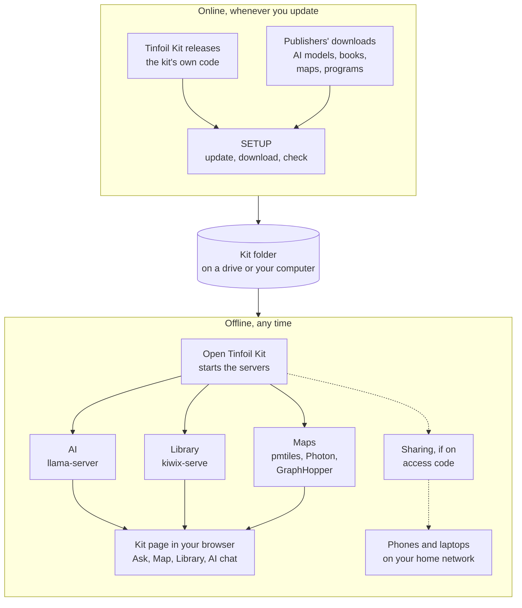

# Tinfoil Kit

An offline kit for when the internet goes down. One folder, on your computer or an external SSD, holds:

- **Local AI** (llama.cpp) that answers from the library and cites its sources.
- **An offline library** (Kiwix): Wikipedia, medical references, repair guides, preparedness manuals.
- **Offline maps** with address search, driving and walking directions, and "nearest hospital".

Open the kit folder (or plug in the drive it's on), double-click `Open Tinfoil Kit.command` (`Open Tinfoil Kit for Windows.bat` on Windows), and a browser page opens with Ask, AI chat, Library and Map tabs. No internet, account or install needed.


## How it works

The whole kit is one folder. Put it on an external drive to grab and go, or on your computer's own disk. While you're online, SETUP fills it. When the internet is down, Open Tinfoil Kit starts a few servers from it on your computer, and your browser talks to them. Nothing goes over the internet. Each is a file you double-click: `SETUP.command` and `Open Tinfoil Kit.command` on a Mac or Linux, `SETUP-Windows.bat` and `Open Tinfoil Kit for Windows.bat` on Windows. On a Mac the Tinfoil Kit app, the website's Mac download, opens them for you: SETUP in Terminal the first time, then the kit, in a window that stops it when you close it.



### Setting up (online)

The first time, SETUP asks where you live (a US state or a country), which sets the maps' area, directions, address search and home, and Wikipedia's language (`./kit region`, from the places in `tools/regions.json`). Then it says which AI model the computer can run (`./kit fit`), and asks where the kit goes: an external drive (`<drive>/TinfoilKit`) or this computer (`~/TinfoilKit`, where it leaves 50 GB free, and on a Mac stays out of Time Machine). `./kit drives` lists the drives with their format, and `./kit space` says whether all of the kit, or just its essentials, fits on each with 10% of the computer's disk (5% of a drive) left free. When all of it won't fit, or leaves less than that, SETUP offers the essentials only (`./kit essentials on`: the AI, the medical, preparedness and repair books, and the map). `./kit place` moves the kit there. Then, that time and every time after, it runs three `./kit` commands (`tools/kit.py`: standard-library Python plus curl). The first time, it gets and checks the essentials before the rest, so the kit works hours earlier.

1. **Update** (`./kit update`): installs the kit's own code from the newest Tinfoil Kit release on GitHub, keeping your changes to `kit.json`. It installs only a release signed with the maintainer's key, and shows what's new and asks first.
2. **Download** (`./kit sync`): asks each publisher for the newest version of everything listed in [kit.json](kit.json) and downloads only what changed. Programs are the exception: each version of the kit names the exact build of each one it installs (`tools/pins.json`), so a new AI engine arrives with a kit update. A big book can wait for its next edition: Wikipedia (115 GB) keeps the one it has until it's a year old (`refresh_days` in kit.json). Downloads resume after a break, every file with a published checksum is checked against it, and an old version is deleted only after the new one checks out.
3. **Check** (`./kit test`): starts every server offline and checks that each one answers.

Windows has no Python, so `SETUP-Windows.bat` first gets python.org's own build from nuget.org (about 15 MB, checked against its SHA-256) and keeps it in `%LOCALAPPDATA%\TinfoilKit`, outside the kit. A Mac's python3 only offers to install Apple's Command Line Tools (several GB) until they're installed, so on a Mac without them `SETUP.command` gets a standalone Python from python-build-standalone on GitHub (about 25 MB, checked against its SHA-256) and keeps it in `~/Library/Application Support/TinfoilKit`, outside the kit (its symlinks wouldn't fit on exFAT). The kit on a drive doesn't need either: Open Tinfoil Kit uses only the programs in the kit (sharing on the home network also needs Python).

### Using it (offline)

`Open Tinfoil Kit.command` (`tools/launch.sh`; `Open Tinfoil Kit for Windows.bat` on Windows) starts these servers on your computer and opens the kit page at http://127.0.0.1:8888. It picks an AI model that fits the computer's memory. Every server listens only on 127.0.0.1, so nothing else on the network can reach them. Sharing, off by default, adds one more on the network.

| Part | Program | Port | What it does |
| --- | --- | --- | --- |
| AI | `llama-server` (llama.cpp) | 8080 | Runs the AI model (Inkling 2 Mini by default). AI chat is its built-in chat page |
| Library | `kiwix-serve` (Kiwix) | 8888 | Serves the books (`.zim` files: Wikipedia, medical, repair, preparedness) with full-text search, and the kit page |
| Map | `pmtiles` | 8090 | Serves the map: street detail where you live (a US state, a country, or part of a big one) and a low-detail world |
| Addresses | Photon | 2322 | Finds addresses, places and the nearest hospital or pharmacy (the whole US by default) |
| Directions | GraphHopper | 8989 | Plans driving and walking routes in your region |
| Sharing (off by default) | `tools/share.py` | 8000 | Lets phones and laptops on your home network in once they type the access code, and passes their requests to the servers above. `./kit share on` turns it on (`.\kit.cmd share on` on Windows), `--share` for one run |

Photon and GraphHopper run on a Java that's in the kit. The kit has each program for Macs, Windows PCs and Linux PCs, so a drive set up on one starts on all three.

The kit page (`tools/portal.html`) is one HTML file with no build step. Each sync builds a copy with the map's code, fonts and icons inside, so the page needs nothing from the internet.

- **Ask:** the AI turns your question into short searches, `kiwix-serve` searches every book, and the AI answers from the top articles with numbered sources. With the AI off, Ask shows the best passages instead. Map questions ("nearest pharmacy", "directions to the hospital") skip the library: the AI gets three map tools (search places, find nearby, get directions), and the answer shows on the Map tab.
- **Map:** MapLibre draws the map from `pmtiles`. Its search, directions and "nearest" buttons ask Photon and GraphHopper.

### What's in the folder

```text
TinfoilKit/
├── SETUP.command             set up, or update whenever you like (online; Mac, Linux)
├── Open Tinfoil Kit.command  start the kit offline (Mac, Linux)
├── UNINSTALL.command         remove the kit and everything it downloaded (Mac, Linux)
├── SETUP-Windows.bat         the same three, for Windows
├── Open Tinfoil Kit for Windows.bat
├── UNINSTALL-Windows.bat
├── GUIDE.md                  the printable guide
├── INVENTORY.md              what's installed, with versions and sizes
├── kit, kit.cmd              the kit's command line (kit.cmd on Windows)
├── kit.json, tools/          its list of downloads, and its code
├── bin/                      programs: llama.cpp, Kiwix, Java, the map servers
├── models/                   AI models
├── library/                  books (.zim files)
├── maps/                     map tiles, address database, road network
├── installers/               the Kiwix app, a backup way to read the books
├── logs/                     what each sync and launch did
└── .kit/                     download progress, caches, the built kit page
```

The repo is the kit, so `site/` (the website), `tests/` and `docs/` come along, but the kit doesn't use them.

## Requirements

- A modern laptop or desktop: a Mac with Apple Silicon, or a Windows or Linux PC. Built around 32 GB of memory; the small model runs on 8-16 GB.
- Room for the kit: the first sync downloads about 300 GB. On the computer's own disk it leaves 50 GB free. An external SSD lets you grab it and go.

A nightly test sets the kit up on a Mac and on Windows, from a download onto the computer and onto an exFAT drive, and starts the Mac's drive on Windows and Linux. On Windows it also builds and serves a small real map, and on all three it shares the kit as a home server.

## Set up

Download the kit from [tinfoilkit.com](https://tinfoilkit.com). Its button picks your computer's file from the [latest release](https://github.com/tudor-city-ventures/tinfoil-kit/releases/latest): `TinfoilKit-Mac.zip`, `TinfoilKit-Windows.zip`, or `TinfoilKit.tar.gz` for Linux. Then:

- **Mac:** open the download (Safari unzips it by itself) and double-click **Tinfoil Kit**. Click **Open** when macOS asks about an app from the internet, let it move itself to Applications, then click **Set Up**: SETUP runs in a Terminal window.
- **Windows:** right-click the ZIP, choose **Extract All**, and double-click `SETUP-Windows.bat` in the TinfoilKit folder. If Windows says it protected your PC, click **More info**, then **Run anyway**.
- **Linux:** run `tar -xf TinfoilKit.tar.gz && bash TinfoilKit/SETUP.command` in a terminal. It needs python3 and curl.

SETUP asks where you live and whether the kit goes on an external drive or on this computer, says how much room each has, moves it there, downloads the essentials and tests them, then gets the rest and tests again. Every answer can also be given up front, so one command sets it up without asking anything: `bash TinfoilKit/SETUP.command --region texas --this-computer --yes`. `--help` lists the options: a drive, just the essentials, which AI models and books, sharing on the home network.

Or from a terminal on a Mac or Linux:

```sh
git clone https://github.com/tudor-city-ventures/tinfoil-kit ~/TinfoilKit    # or /Volumes/<drive>/TinfoilKit
cd ~/TinfoilKit
./kit plan    # preview what will download
./kit sync    # download everything (a few hours)
./kit test    # start every server offline and check it answers
```

Then turn Wi-Fi off and open the Tinfoil Kit app, or double-click `Open Tinfoil Kit.command` in the kit folder (`Open Tinfoil Kit for Windows.bat` on Windows). [GUIDE.md](GUIDE.md) is the printable guide that lives in the kit folder.

## Update

Double-click SETUP again whenever you want the newest models, books and maps, or run `./kit update`, `./kit sync` and then `./kit test`. There's no schedule. It installs the kit's newest version first, so models and sources added to the kit since then arrive too, and then downloads only what changed (see [How it works](#how-it-works)). If an update is cut off, the kit keeps working with what it has.

## Remove

Double-click `UNINSTALL.command` (`UNINSTALL-Windows.bat` on Windows) in the kit folder. It says what it will delete and how much space that frees, and deletes the kit and everything it downloaded only after you type `delete`. On a drive, nothing else is touched. It also removes the Python SETUP got, on Windows or on a Mac without its own. `--yes` skips the question.

## Home server

A computer that stays on (Linux, a Mac mini or a Windows PC) can serve the kit to every phone and laptop at home. `bash SETUP.command --home-server` (`.\SETUP-Windows.bat --home-server` on Windows) sets it up as usual, then shares it on the home network behind an access code and starts it with the computer (a systemd user service on Linux, from boot; a LaunchAgent on a Mac or the Startup folder on Windows, once you log in). Phones open the address it shows and type the code, or scan its QR code. Programs can use the code as an API key for the AI's OpenAI-compatible API: `Authorization: Bearer <code>` at `http://<server>:8000/ai/v1`. Details: [GUIDE.md](GUIDE.md#a-home-server-advanced).

## Security

The kit downloads programs and runs them on your computer, so here is what protects you and what doesn't. Report problems privately, as [SECURITY.md](.github/SECURITY.md) says.

- **Signed updates.** `./kit update` installs new code only if the maintainer's release key signed it, checked against `tools/release-signers` in the copy you already have. That key never goes near GitHub, so someone who broke into the GitHub account or its Actions still couldn't ship an update your kit accepts. A new key arrives only in a release the old one signed, and the kit shows what's new and asks before it installs anything.
- **Downloads straight from their publishers,** over HTTPS (the list is in [THIRD-PARTY.md](THIRD-PARTY.md)). This project hosts none of them. Each release names the exact build of every program it installs, with that file's SHA-256, in `tools/pins.json`, signed with the rest: a program file that changes after the release is refused. Books, models and map data are checked against the checksum their publisher posts, before they replace the old version. Files without one, like the map tiles and fonts, rely on HTTPS alone.
- **No telemetry.** No accounts, analytics or reports home, in the kit or on tinfoilkit.com. The kit goes online only when you run SETUP, `./kit sync` or `./kit update`, and then only to GitHub and the places it downloads from.
- **No administrator password.** The kit runs as you, and starts only when you start it unless you set up a home server. UNINSTALL undoes everything setup did. The site's "What does setup change on my computer?" lists every change outside the kit folder.
- **Servers on 127.0.0.1.** The AI, library and maps answer only this computer. A website open while the kit runs can still reach them, as browsers allow: it could read the books and maps and use the AI as the kit page does (the directions server answers any page, and DNS rebinding opens the rest). Chrome asks your permission before a website reaches your computer's own servers; other browsers may not.
- **Sharing is off until you turn it on.** Then one gate, on port 8000 by default, stands in front of everything: it asks for an 8-digit code, stops answering a device after 10 wrong tries in 10 minutes, and refuses addresses and names outside a home network, so other websites can't reach it. It's plain HTTP, so share on your own Wi-Fi or hotspot: anyone on a public network who watches the traffic could read the code.
- **Readable code.** Python's standard library, shell scripts and one HTML page, with no packages to install and no build step. It's written with AI coding tools; the tests in `tests/` run it against mocks of every download source and server on every change.
- **The repo.** Every GitHub Action is pinned to a commit and runs with a read-only token, except a few jobs that never run code from a pull request or a download. An outside pull request that touches the workflows, CODEOWNERS, the release key or the program pins fails a check that only the maintainer can merge past.
- **What it can't protect against:** a bad file from a hacked publisher, if it's a book, model or map (its checksum comes from the same place as the file) or a program that was already bad when a release pinned it; someone with your unlocked computer or drive, since the kit isn't encrypted (use FileVault, BitLocker or an encrypted drive for that); and an AI answer that's wrong, so check its sources.

To check a release before running it, download its `tinfoilkit-TAG.tar.gz` and `.sig` (the downloads the website links to are protected by HTTPS alone) and run:

```sh
ssh-keygen -Y verify -f tools/release-signers -I tinfoilkit-release -n tinfoilkit-release \
  -s tinfoilkit-TAG.tar.gz.sig < tinfoilkit-TAG.tar.gz
# and that it's exactly the tagged code, from a clone of this repo:
git archive --format=tar --prefix=tinfoilkit-TAG/ TAG | shasum -a 256
gunzip -c tinfoilkit-TAG.tar.gz | shasum -a 256
```

## Customize

Everything the kit keeps is listed in [kit.json](kit.json). Set `"enabled": false` to skip an item, or find more books with `./kit search WORDS`.

## Contributing

Bug reports and ideas are welcome as issues. A pull request needs an issue the maintainer has labeled `accepted` first: see [CONTRIBUTING](.github/CONTRIBUTING.md). Code rules, for people and their AI agents, are in [AGENTS.md](AGENTS.md). Design history is in [docs/HANDOFF.md](docs/HANDOFF.md).

## Built on

Tinfoil Kit is glue around free projects that do the work. If the kit helps you, give to them: [Kiwix](https://support.kiwix.org/), [Wikipedia](https://donate.wikimedia.org/), [OpenStreetMap](https://supporting.openstreetmap.org/), [Protomaps](https://github.com/sponsors/protomaps) and [MapLibre](https://opencollective.com/maplibre). [llama.cpp](https://github.com/ggml-org/llama.cpp) runs the AI, and [GraphHopper](https://github.com/graphhopper/graphhopper) and [Photon](https://github.com/komoot/photon) plan routes and find addresses: a star or a good bug report helps them.

## License

The kit's code is [MIT](LICENSE). Everything it downloads (models, books, maps, programs) comes from its publisher under its own license: see [THIRD-PARTY.md](THIRD-PARTY.md). Some of it forbids commercial use, so don't sell drives filled with the kit.
