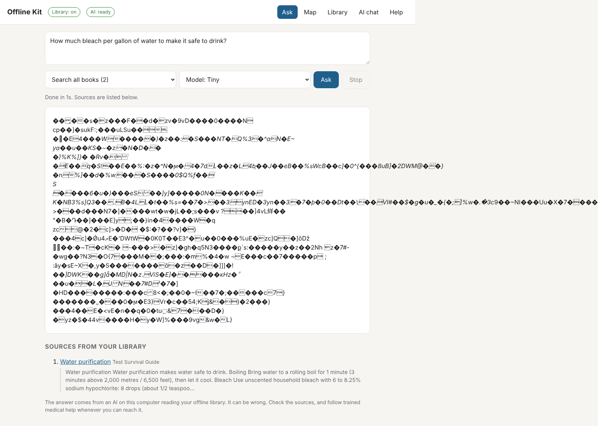
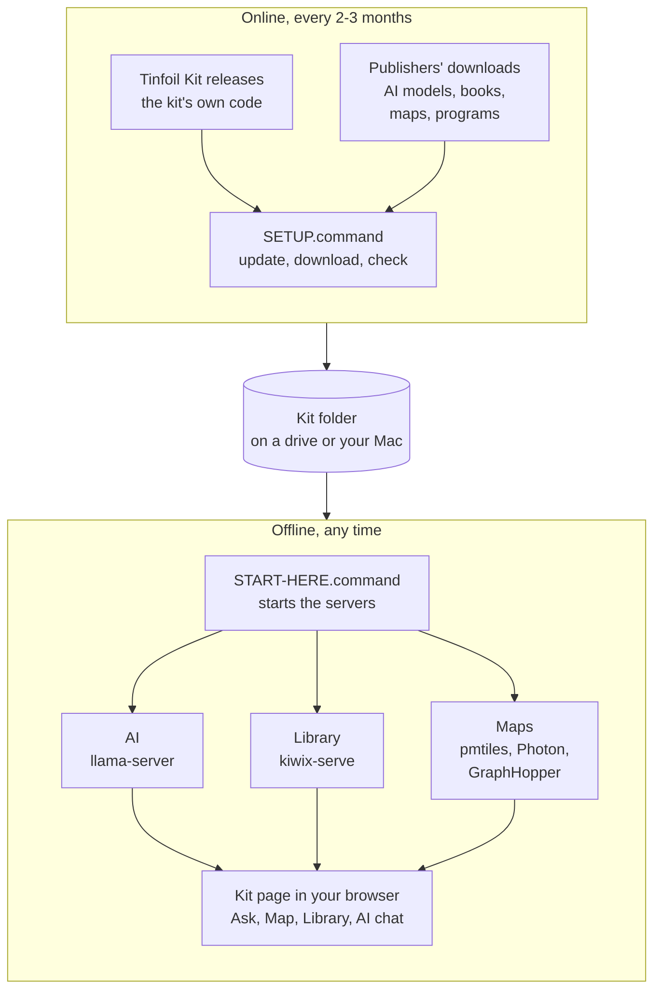

# Tinfoil Kit

An offline kit for when the internet goes down. One external SSD holds:

- **Local AI** (llama.cpp) that answers from the library and cites its sources.
- **An offline library** (Kiwix): Wikipedia, medical references, repair guides, preparedness manuals.
- **Offline maps** with address search, driving and walking directions, and "nearest hospital".

Plug in the drive, double-click `START-HERE.command`, and a browser page opens with Ask, AI chat, Library and Map tabs. No internet, account or install needed.



## How it works

The whole kit is one folder. Put it on an external drive to grab and go, or on your Mac's own disk. While you're online, `SETUP.command` fills it. When the internet is down, `START-HERE.command` starts a few servers from it on your Mac, and your browser talks to them. Nothing goes over the internet.



### Setting up (online)

`SETUP.command` runs three `./kit` commands (`tools/kit.py`: standard-library Python plus curl):

1. **Update** (`./kit update`): installs the kit's own code from the newest Tinfoil Kit release on GitHub, keeping your changes to `kit.json`.
2. **Download** (`./kit sync`): asks each publisher for the newest version of everything listed in [kit.json](kit.json) and downloads only what changed. Downloads resume after a break, every file with a published checksum is checked against it, and an old version is deleted only after the new one checks out.
3. **Check** (`./kit test`): starts every server offline and checks that each one answers.

### Using it (offline)

`START-HERE.command` (`tools/launch.sh`) starts these servers on your Mac and opens the kit page at http://127.0.0.1:8888. It picks an AI model that fits the Mac's memory and keeps the Mac awake. `bash START-HERE.command --share` lets phones on the same Wi-Fi use it too.

| Part | Program | Port | What it does |
| --- | --- | --- | --- |
| AI | `llama-server` (llama.cpp) | 8080 | Runs the AI model (Inkling 2 Mini by default). AI chat is its built-in chat page |
| Library | `kiwix-serve` (Kiwix) | 8888 | Serves the books (`.zim` files: Wikipedia, medical, repair, preparedness) with full-text search, and the kit page |
| Map | `pmtiles` | 8090 | Serves the map: street detail for your region (the US Northeast by default) and a low-detail world |
| Addresses | Photon | 2322 | Finds addresses, places and the nearest hospital or pharmacy (the whole US by default) |
| Directions | GraphHopper | 8989 | Plans driving and walking routes in your region |

Photon and GraphHopper run on a Java that's in the kit. On Windows (`START-HERE-Windows.bat`) and Linux, only the AI and the library start.

The kit page (`tools/portal.html`) is one HTML file with no build step. Each sync builds a copy with the map's code, fonts and icons inside, so the page needs nothing from the internet.

- **Ask:** the AI turns your question into short searches, `kiwix-serve` searches every book, and the AI answers from the top articles with numbered sources. With the AI off, Ask shows the best passages instead. Map questions ("nearest pharmacy", "directions to the hospital") skip the library: the AI gets three map tools (search places, find nearby, get directions), and the answer shows on the Map tab.
- **Map:** MapLibre draws the map from `pmtiles`. Its search, directions and "nearest" buttons ask Photon and GraphHopper.

### What's in the folder

```text
TinfoilKit/
├── SETUP.command           set up or refresh (online)
├── START-HERE.command      start the kit (offline)
├── START-HERE-Windows.bat  start it on a Windows PC
├── GUIDE.md                the printable guide
├── INVENTORY.md            what's installed, with versions and sizes
├── kit, kit.json, tools/   the kit's code and its list of downloads
├── bin/                    programs: llama.cpp, Kiwix, Java, the map servers
├── models/                 AI models
├── library/                books (.zim files)
├── maps/                   map tiles, address database, road network
├── installers/             the Kiwix app, a backup way to read the books
├── logs/                   what each sync and launch did
└── .kit/                   download progress, caches, the built kit page
```

The repo is the kit, so `site/` (the website), `tests/` and `docs/` come along, but the kit doesn't use them.

## Requirements

- An Apple Silicon Mac. Built around 32 GB of memory; smaller Macs start with the small model.
- An external SSD with room for the kit. The first sync downloads about 300 GB.

Windows and Linux work as a fallback (library and AI, no map). A nightly test sets the kit up on a Mac and starts it on both.

## Set up

Copy this folder onto the drive (**Code > Download ZIP** on GitHub, unzip, and rename `tinfoilkit-main` to `TinfoilKit`) and double-click `SETUP.command`. It checks the drive, downloads everything and tests it. Or from Terminal:

```sh
git clone https://github.com/tudor-city-ventures/tinfoilkit /Volumes/<drive>/TinfoilKit
cd /Volumes/<drive>/TinfoilKit
./kit plan    # preview what will download
./kit sync    # download everything (a few hours)
./kit test    # start every server offline and check it answers
```

Then turn Wi-Fi off and double-click `START-HERE.command`. [GUIDE.md](GUIDE.md) is the printable guide that lives on the drive.

## Keep it fresh

Double-click `SETUP.command` (or run `./kit update`, `./kit sync` and then `./kit test`) every two to three months. It updates the kit's own code, then downloads only what changed (see [How it works](#how-it-works)).

## Customize

Everything the kit keeps is listed in [kit.json](kit.json). Set `"enabled": false` to skip an item, or find more books with `./kit search WORDS`.

## Contributing

Bug reports and ideas are welcome as issues. A pull request needs an issue the maintainer has labeled `accepted` first: see [CONTRIBUTING](.github/CONTRIBUTING.md). Code rules, for people and their AI agents, are in [AGENTS.md](AGENTS.md). Design history is in [docs/HANDOFF.md](docs/HANDOFF.md).

## License

The kit's code is [MIT](LICENSE). Everything it downloads (models, books, maps, programs) comes from its publisher under its own license: see [THIRD-PARTY.md](THIRD-PARTY.md). Some of it forbids commercial use, so don't sell drives filled with the kit.
